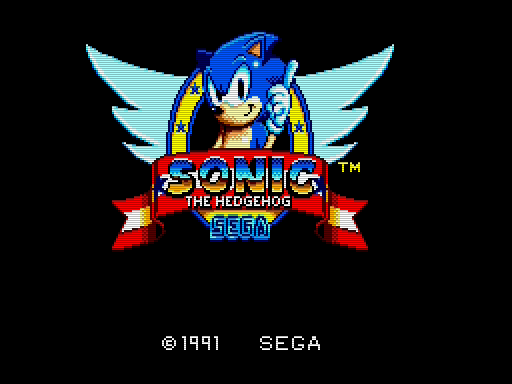
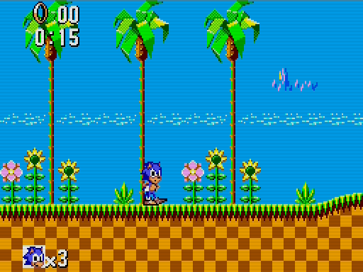
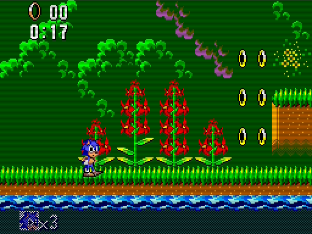
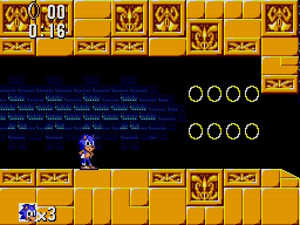
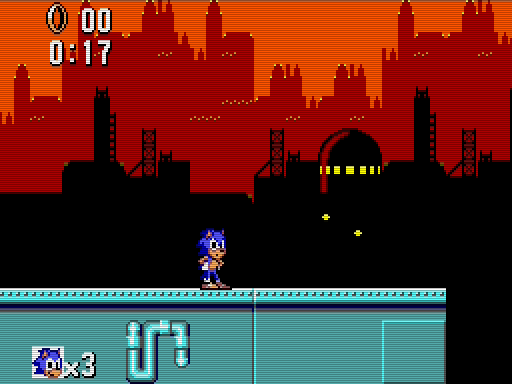
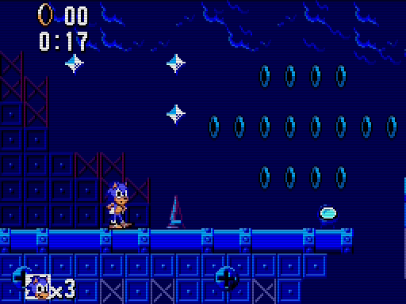

# Sonic A8 VBXE

A fan-made port of **Sonic The Hedgehog** (Sega Master System, 1991) for the **Atari XL/XE** with the **VBXE** graphics card.

The game logic was translated from the original Z80 code into 6502 assembly; graphics, levels and sound effects are
converted from the original ROM at build time, and the music comes from the C64 SID version converted to POKEY.


%20and%20Python-orange)

-green)

<p align="center">
  
  
  
  <br>
  
  
  
</p>

## Features

- All six zones of the original – Green Hill, Bridge, Jungle, Labyrinth, Scrap Brain and Sky Base – with their acts
  and bosses, plus the special stages.
- Title screen, map, act results, game over, continue and ending screens.
- Music on POKEY, sound effects converted from the original.
- Runs from XEX, cartridge (AtariMax 1 MB, SIC! 512 KB) or floppy disks (one large ATR or three ED disks for a stock 1050).
- Cracktro with a trainer: infinite lives and a choice of the starting zone.

## Requirements

| | |
|---|---|
| Computer | Atari 800XL / 65XE / 130XE or compatible, PAL or NTSC |
| Graphics | **VBXE** (tested with the FX 1.26 core) |
| Memory | cartridge and disk versions: at least **320 KB** (RAMBO); XEX version: **1088 KB** (Ultimate 1MB) |
| Emulator | [Altirra](https://www.virtualdub.org/altirra.html) 4.31 or newer with VBXE enabled and the matching memory size |

## Download

Get the latest release from the [Releases](../../releases) page. The ZIP contains:

| File | Format | Use with |
|---|---|---|
| `sonic-a8-vbxe.xex` | XEX | SIO devices (SDrive-MAX, FujiNet, SIO2PC) and multicarts – requires 1088 KB |
| `sonic-atarimax.car` | CAR type 42 | AtariMax 1 MB cartridge (old layout, starts from bank 127) |
| `sonic-atarimax75.car` | CAR type 75 | AtariMax 1 MB cartridge (new hardware, starts from bank 0) |
| `sonic-atarimax.bin` | raw 1 MB ROM | flashing an AtariMax 1 MB cartridge |
| `sonic-sic512.car` | CAR type 56 | SIC! 512 KB cartridge |
| `sonic-a8-vbxe.atr` | ATR, MyDOS DD | one disk with the whole game, for SIO devices that support large ATR images |
| `sonic-ed1.atr` … `sonic-ed3.atr` | ATR, DOS 2.5 ED | three disks for a stock 1050 drive – boot disk 1, the game asks for disk 2 at Bridge Zone 1 and for disk 3 at Scrap Brain Zone 1 |

## Controls

Joystick in port 1: left / right – run, down – roll or crouch, fire – jump.

In the cracktro: up / down – select an option, left / right – change it, space or fire – start the game.

## Building from source

The build runs on **Windows**. The assembler (MADS 2.1.8) and the packing tools are included in `tools/bin`.

1. Install **Python 3.13** (or newer 3.x) and the required packages:
   ```
   python -m pip install -r requirements.txt
   ```
2. Put **your own dump** of the Sega Master System ROM into `assets\rom\sms\` (any `*.sms` file name). The ROM is
   not included in this repository; the build checks it and stops if it is missing or a different version:

   | ROM | Size | SHA-256 |
   |---|---|---|
   | Sonic The Hedgehog (USA, Europe, Brazil) | 262 144 bytes | `6ad738965ece231427ee046b9905cfee470d5c01220afdd934da4673e4a2458b` |

3. Build:
   ```
   tools\build.cmd release
   ```
   The release files are written to `dist\` together with `dist\sonic-a8-vbxe-v1.0.zip`. Single formats can be built with
   `tools\build.cmd xex`, `cart` or `atr` (output in `build\`).

If `python` is not on `PATH`, set `PYTHON` to the full path of `python.exe` before running the build.

## Repository layout

```
src/asm/      6502 source code of the game (MADS)
src/data/     binary data included by the source (cracktro font and music)
music/        game music – POKEY register dumps (SAP-R) converted from the C64 SID version
tools/        build scripts: data extraction from the ROM, packing, cartridge and disk image builders
tools/bin/    MADS, zx02, dir2atr, xBIOS
tools/data/   sound effect data recorded from the original game
licenses/     licenses of the included third-party tools
docs/         screenshots
dist/         README of the release package
```

## Credits

Sonic The Hedgehog © SEGA. Port by **madness77**. Music by Masato Nakamura and Yuzo Koshiro, C64 arrangement by
Encore (Mikkel Hastrup), converted to POKEY with sid2sapr by Ivo van Poorten. Third-party tools: MADS (Tomasz Biela),
zx02 and lzss-sap (Daniel Serpell), dir2atr (Matthias Reichl), xBIOS (XXL). Full list: [CREDITS.md](CREDITS.md).

## Legal

Sonic A8 VBXE is a non-commercial fan project. It is not affiliated with, endorsed or sponsored by SEGA. Sonic The Hedgehog,
its characters, graphics, music and sound effects are the property of SEGA. No ROM image of the original game is
included in this repository.

**Use of the game and its data in any way for profit is prohibited.**

## License

The build tools in `tools/` (the Python scripts and `build.cmd`) are released under the [MIT License](LICENSE).
The license does not cover the game code in `src/`, the game data or the third-party files – see [LICENSE](LICENSE)
and [CREDITS.md](CREDITS.md).
